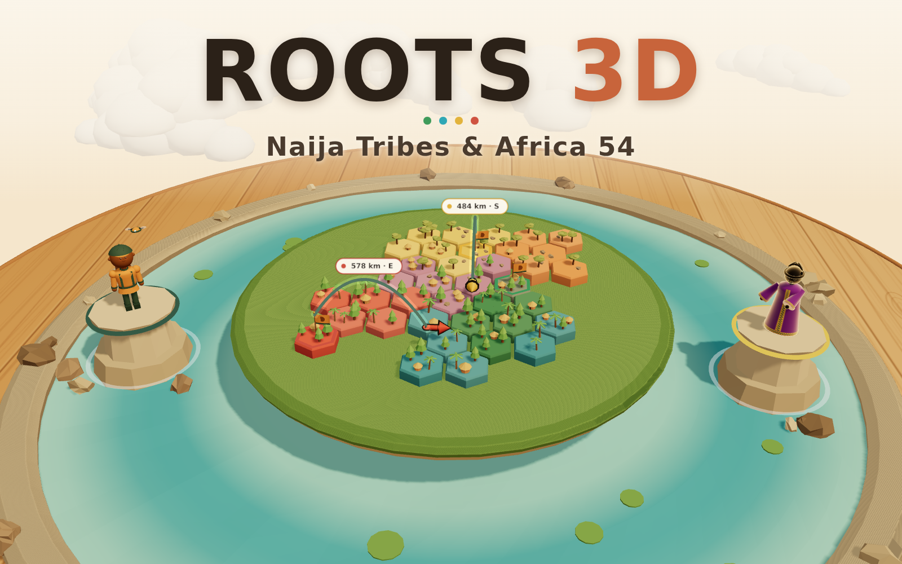
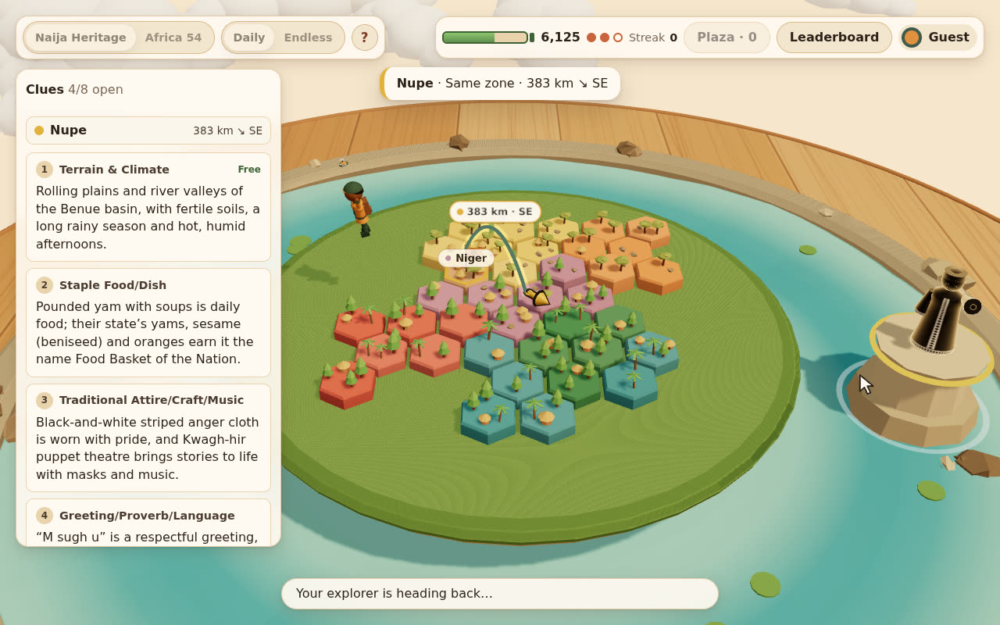
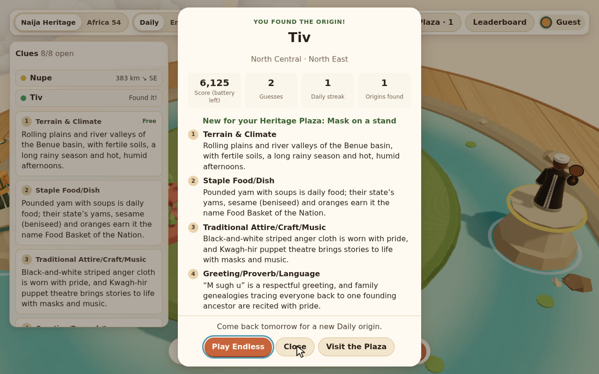
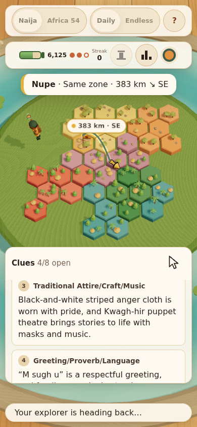

# ROOTS 3D: Naija Tribes & Africa 54



**A 3D daily guessing game about where people come from: read the clues, then find the Nigerian tribe or African country.**

<h3 align="center"><a href="https://naija-roots.start.ng">Play now at naija-roots.start.ng</a></h3>

## 🌍 What is it

A mystery storyteller stands on a pedestal and hides where they come from. Your job is to find their origin: a Nigerian tribe in Naija Heritage, or one of Africa's 54 countries in Africa 54.

Unlock clues and drop guesses on a 3D map, but watch your 10,000-point expedition battery. Every extra clue and every wrong guess drains it.

## 🎯 How to play

**Two ways to play**

- **Naija Heritage:** guess the Nigerian tribe.
- **Africa 54:** guess which of Africa's 54 countries.

**Clues.** You start with a 10,000-point battery. The first clue is free. Each extra clue costs more than the one before, from 250 up to 1,750 points. Clues start subtle and get easier: terrain, food, attire and music, greetings and proverbs, festivals, history, region and neighbours, then a ruler's title or a landmark. Every clue also reveals a little more of the storyteller.

**Guessing.**

- **Naija Heritage:** tap a state, pick a tribe (or search the full list), then Confirm.
- **Africa 54:** tap a country, then Confirm. On phones, the first tap zooms in and the second tap picks.

You have three guesses. Each wrong guess costs 30% of your remaining battery.

**What the colours mean**

| Colour | Meaning |
| --- | --- |
| **Green** | You found it. |
| **Cyan** | Very close. The tribe shares a state with the answer, or the country borders it. |
| **Yellow** | Getting warm. Same geopolitical zone, or same region of Africa. |
| **Red** | Further away. |

Every miss also shows how many km off you are and an arrow pointing toward the answer.

Many tribes live across more than one state, and many states are home to several tribes. Think culture and heritage, not just one spot on the map.

**Daily and Endless**

- **Daily:** one mystery per mode, the same for everyone, once a day. A new one arrives at 1:00 AM Nigeria time (00:00 UTC). Daily wins count towards your Best expedition and Daily streak.
- **Endless:** play as many as you like.

Every new origin you solve, Daily or Endless, adds a monument to your Heritage Plaza.

Sign in with start.ng to play as your own character and save your scores to the leaderboard.

## ✨ Features

- **Two modes:** 67 Nigerian tribes across all 36 states + FCT, and all 54 African countries.
- **A 3D tabletop diorama:** a sunlit wooden table, a water basin, a floating island and hex-tile maps of Nigeria and Africa.
- **Your start.ng character:** your explorer is built from your start.ng avatar style, and flies out to plant a flag on every guess.
- **A progressive storyteller reveal:** the storyteller starts as a silhouette and shows a little more of their attire with every clue.
- **Distance and direction feedback:** each miss draws a glowing arc with the distance in km and an arrow pointing toward the answer.
- **Daily seed:** one shared mystery per mode each day, the same for every player.
- **Endless and the Heritage Plaza:** keep playing, and watch a monument for each new origin you solve appear around the island.
- **Leaderboard:** Best expedition, Daily streak and Origins found, saved through start.ng.
- **Mouse and touch:** drag to orbit, scroll or pinch to zoom, click or tap to pick. The layout adapts from desktop down to small phones.

## 📸 Screenshots

<p align="center">
  
  
</p>
<p align="center"><em>Left: a yellow guess, with the arc, distance and direction. Right: the win card.</em></p>

<p align="center">
  
</p>
<p align="center"><em>The same moment on a phone.</em></p>

## 🧱 Built with

- [three.js](https://threejs.org) r160 (MIT licence), loaded from a local copy through an import map.
- Plain ES modules, with no build step and no dependencies.
- Everything is modelled and textured procedurally in code: no model files, image textures, fonts or CDNs.
- [start.ng](https://start.ng) for sign-in, hosting and leaderboards.

## 💻 Run it locally

ES modules don't load from `file://`, so serve the folder with any static server:

```bash
git clone https://github.com/Collinsthegreat/naija-roots.git
cd naija-roots
python3 -m http.server 8000
```

Then open <http://localhost:8000>.

Sign-in and the leaderboard only work on start.ng. Locally you play as an offline guest, and your progress is saved in the browser.

## ⚙️ How it works

- **Fixed timestep.** The world advances only in fixed 1/60 s simulation steps. Animation, camera damping, particles and flights all read simulation time, never the clock. All randomness comes from seeded `mulberry32` streams (`rng.js`); `Math.random()` is never used.
- **Daily seed.** The Daily mystery is `hashString("roots3d:<mode>:<YYYY-MM-DD>")` of today's UTC date, used as an index into the dataset sorted by id. Every player gets the same mystery, and it changes at 00:00 UTC. Endless rounds use their own per-round seeds.
- **`?capture` mode.** Add `?capture` to the URL and the game starts no animation loop and makes no network calls. Instead it exposes `window.render(t)`, which steps the simulation to `t` seconds and draws exactly one frame. A scripted 45-second showcase, with a demo cursor driving the real UI, can then be recorded frame by frame with identical results every time.
- **Hex-tile boards.** Each state or country is one hex tile in a hand-tuned cartogram (`board-layout.js`). Tiles are drawn with `InstancedMesh` and picked by raycasting; trees, rocks, particles and plaza plinths are instanced too.
- **start.ng connect bridge.** On `*.start.ng`, the game opens start.ng's hidden connect page in an iframe and talks to it with `postMessage`: who is playing, saving a score and reading the leaderboard. Replies are checked against start.ng's origin. Anywhere else, or if start.ng doesn't answer, the game carries on as an offline guest.

## 🗂️ Project structure

| Path | What it does |
| --- | --- |
| `index.html` | Page markup, import map, HUD containers and all CSS |
| `main.js` | Boot, renderer, the fixed-step loop, capture mode and module wiring |
| `game.js` | Pure game rules: battery, clues, guesses, colour tiers, Daily and Endless picks |
| `flow.js` | The game controller between rules, board, effects, HUD, progress and start.ng |
| `rng.js` | `mulberry32`, `hashString` and seeded pick and shuffle helpers |
| `geom.js` | Small geometry and maths helpers |
| `scene.js` | The diorama: table, water, island, clouds, pedestals and lighting |
| `camera.js` | The damped orbit camera, with drag, wheel and pinch input |
| `textures.js` | Procedural canvas textures from seeded PRNGs |
| `board.js` | The two hex-tile map boards, picking and camera focus |
| `board-layout.js` | Hex cartogram layouts for Nigeria and Africa (pure maths) |
| `board-parts.js` | Shared tile, tree and rock geometry and materials |
| `board-labels.js` | Region-name labels drawn from one texture atlas per board |
| `avatar.js` | Your explorer, built from your start.ng avatar style |
| `avatar-parts.js` | Procedural hair, hats and accessories for the explorer |
| `npc.js` | The mystery storyteller and its reveal stages |
| `npc-parts.js` | Storyteller headgear and props |
| `fx.js` | Explorer flights, flags, arcs, arrows, tier pulses and confetti |
| `fx-parts.js` | Instanced particle pools, arcs, arrows and distance labels |
| `plaza.js` | The Heritage Plaza monuments around the island's rim |
| `plaza-parts.js` | Monument models for the plaza |
| `progress.js` | Progress saved on this device: best Daily, streaks, origins solved |
| `storage.js` | Versioned `localStorage` that keeps working when storage is blocked |
| `ui.js` | The HUD: top bar, clue cards, guess bar, toasts and the results card |
| `ui-pick.js` | Tribe and country pickers, with search |
| `ui-help.js` | The in-game "How to play" panel |
| `ui-leaderboard.js` | The leaderboard panel |
| `startng.js` | The start.ng connect bridge and the offline-guest fallback |
| `startng.json` | Leaderboard columns for start.ng |
| `capture.js` | The scripted 45-second `?capture` showcase |
| `cover.js` | The deterministic 1600×1000 `?cover` view |
| `debug.js` | Debug views (`?avatars`, `?npc`) |
| `data/nigeria.js` | Nigeria's 36 states + FCT, grouped into the six geopolitical zones |
| `data/tribes.js` | The 67-tribe roster and the states each tribe lives in |
| `data/africa.js` | The 54 African countries, grouped by AU region |
| `data/clues/` | Clue text: 8 clues for every tribe and country |
| `data/validate.js` | Data checks, run with `?debug` |
| `three.module.js` | three.js r160, unmodified |
| `cover.png` | The 1600×1000 cover image |
| `screenshots/` | The images in this README |

## 🤝 About the cultural content

The clues are written to be respectful and celebratory. They focus on landscapes, food, dress, music, greetings, festivals, history and landmarks, and the storyteller is a stylised figure, never a caricature.

Nigeria and Africa are vast and varied, and no short clue can capture a whole people. If you spot something inaccurate or that could be put better, please [open an issue](https://github.com/Collinsthegreat/naija-roots/issues). Corrections are very welcome.

## 🙏 Credits

- Built by Collins for the HNG Internship (HNG15).
- Hosted on [start.ng](https://start.ng).
- [three.js](https://threejs.org) by its contributors.
- The mechanic is inspired by daily origin-guessing games such as originle.io.

## Licence

© 2026 Collins. All rights reserved.

`three.module.js` is three.js r160, © three.js authors, under the MIT licence.
